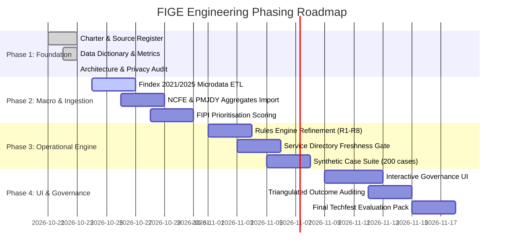

# Financial Inclusion Governance Engine (FIGE): Implementation Roadmap

**Document Classification:** Engineering Roadmap, Phasing & Milestone Plan  
**Version:** 1.0.0 (Phase 1 Baseline)  
**Date:** 23 October 2026  
**Auditor Rule:** Keep delivery staged, verifiable, and tied to strict validation gates. Do not jump to full application execution before foundation layers are documented and verified.

---

## 1. Phasing Overview & Execution Status

The FIGE platform development follows a four-phase sequential roadmap designed to ensure that empirical rigor, statutory compliance, and privacy safeguards are baked in from the ground up:

---

## 2. Phase-by-Phase Milestone Breakdown

### 2.1 Phase 1: Project Foundation & Architecture (CURRENT STATUS: COMPLETED)
- **Objective:** Establish the intellectual, regulatory, and architectural baseline.
- **Key Deliverables:**
  - `docs/PROJECT_CHARTER.md`: Foundational charter and core policy objectives.
  - `docs/DATA_SOURCE_REGISTER.md`: Audit of 11 candidate datasets with ownership, URLs, and extraction statuses.
  - `docs/DATA_DICTIONARY.md`: Two-tier schema specifications (Macro survey indicators + operational entities).
  - `docs/METRIC_DEFINITIONS.md`: Mathematical formulations for SIR, AIR, GIG, FLBR, FIPI, TFS, and Triangulated Outcomes.
  - `docs/DATA_GAPS_AND_ASSUMPTIONS.md`: Epistemic audit documenting structural gaps and synthetic assumptions.
  - `docs/TECHNICAL_ARCHITECTURE.md`: Full architectural blueprint (FastAPI, React, SQLite/Postgres migration, RBAC).
  - `docs/IMPLEMENTATION_ROADMAP.md`: Staged 4-phase delivery plan.
  - `docs/PRIVACY_AND_GOVERNANCE.md`: DPDP Act 2023 alignment and RBI regulatory compliance constraints.
  - `docs/TEST_STRATEGY.md`: Test pyramid, validation criteria, and edge-case testing protocol.
- **Validation Gate:** All 9 core documentation files created and cross-referenced; existing 20/20 backend unit tests verified passing.

---

### 2.2 Phase 2: Ingestion Pipeline & Macro Prioritisation Engine
- **Objective:** Build reproducible, automated data ingestion pipelines for verified public data and implement the geographic prioritisation engine.
- **Deliverables:**
  1. `backend/ingestion/`:
     - `ingest_findex.py`: Parses Global Findex microdata (2021 & 2025 rounds), validates survey weights, and computes population-weighted inactivity and barrier rates.
     - `ingest_ncfe.py`: Ingests state-level financial literacy scores from NFLIS-2019 report tables.
     - `ingest_pmjdy.py`: Ingests DFS progress snapshots with automated snapshot date stamping.
     - `ingest_npci.py`: Ingests UPI and AePS monthly transaction volume and value series.
  2. `backend/scoring/fipi.py`:
     - Vectorized implementation of the Financial Inclusion Prioritisation Index (FIPI) at state and district levels.
     - Implementation of missing-indicator confidence penalty algorithms.
  3. `backend/tests/test_macro_scoring.py`:
     - Unit tests verifying formula normalisation, zero-handling, and weight boundary invariants.
- **Datasets Scheduled for Download & Extraction:**
  - World Bank Global Findex 2021 India microdata CSV.
  - World Bank Global Findex 2025 India microdata catalogue files.
  - NCFE NFLIS-2019 Table 4.1 & 4.2 state datasets.
  - DFS PMJDY progress snapshot dated 28 Feb 2025.
  - Lok Sabha unstarred question text on PMJDY inoperative counts (22 Jan 2025).

---

### 2.3 Phase 3: Operational Decision Engine & Service Directory Governance
- **Objective:** Refine the deterministic case routing engine, touchpoint verification gates, and synthetic edge-case suite.
- **Deliverables:**
  1. `backend/rules.py`:
     - Production refinement of Rules R1 to R8 ensuring 100% test coverage across all decision branches.
     - Strict execution of Rule R3 (blocking referrals to any service point unverified $>90$ days).
     - Execution of Rule R1 (suppressing outreach immediately upon customer opt-out).
  2. `backend/service_directory.py`:
     - Touchpoint freshness monitor and automated audit alert triggers.
  3. `backend/generator.py`:
     - Expansion of the 200 synthetic edge-case dataset, including deliberately malformed rows and schema edge cases to stress-test validation pipelines.
  4. `backend/tests/test_rules.py` & `test_edge_cases.py`:
     - Automated verification of zero false reactivations and zero outreach to opted-out citizens.

---

### 2.4 Phase 4: User Experience, Policy Feedback & Validation
- **Objective:** Deliver the interactive React + TypeScript governance dashboard, full end-to-end integration, and submission packaging.
- **Deliverables:**
  1. Frontend Enhancements (`frontend/src/components/`):
     - Interactive Geographic Priority Map / Table displaying composite FIPI scores with drill-downs into component indicators.
     - Case Decision Studio with inspectable rule triggers and consent controls.
     - Service Directory Manager with live 90-day staleness indicators and audit log viewer.
     - Non-dismissible "SYNTHETIC DEMO" watermarking across all operational screens.
  2. Policy Feedback Module:
     - Aggregated reporting dashboard for SLBCs showing touchpoint referral drop-off rates and barrier prevalence.
  3. Final Evaluation & Demonstration Package:
     - End-to-end test execution report (`TEST_REPORT.md`).
     - Quickstart script (`run_demo.bat` / `run_demo.sh`) enabling one-click evaluation by the IIT Bombay Techfest jury.

---

## 3. Risk Management & Mitigations

| Risk Description | Probability | Impact | Mitigation Strategy |
|---|---|---|---|
| **Evaluator confuses synthetic demo cases with real citizen data** | High | Critical | Prominent amber visual banners on every UI screen; explicit API headers (`X-Synthetic-Demo: true`); schema-enforced `is_synthetic = 1`. |
| **Microdata download delays or restrictive licensing terms** | Medium | Medium | Maintain pre-extracted verified summary tables in `docs/` and fallback to verified public aggregates. |
| **Accidental claim of automatic regulatory compliance** | Medium | High | Reframe all regulatory mentions as compliance constraints and verification tests rather than certifications. |
| **Scope creep toward building a commercial consumer app** | Low | High | Strict adherence to Project Charter: FIGE is a decision-support and institutional governance engine, not a neo-bank. |
