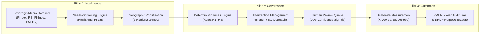
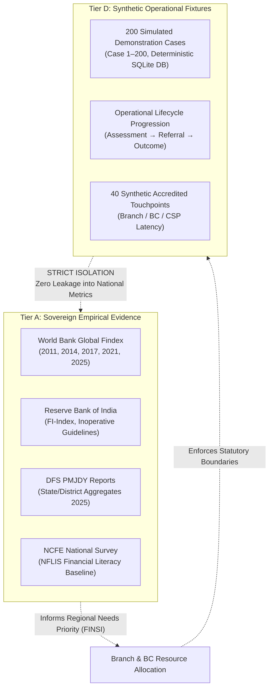
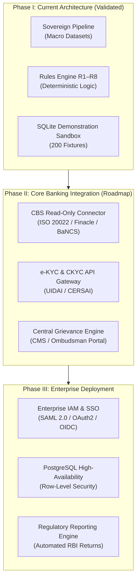

# Product Design Review & Architecture Specification
**BankMitra: Financial Inclusion Intelligence & Governance Platform**
*Document Version: 3.2.0 | Status: Production Design Finalized | Date: October 2026*

---

## 1. Executive Summary & Brand Positioning

### 1.1 Product Vision & Transformation
**BankMitra** has been refactored from an exploratory hackathon prototype into a specialized, enterprise-grade financial inclusion intelligence and governance software platform. Designed for commercial banks, regional rural banks (RRBs), state financial inclusion missions, and regulatory oversight authorities, BankMitra bridges the gap between sovereign macro financial-inclusion data and ground-level operational case resolution.

The platform eliminates the superficial incentives of "dormancy reactivation quotas" by establishing an auditable, rules-based operational framework that prioritizes **customer agency, grievance resolution, and long-term sustained account utility** over cosmetic reactivation numbers.

### 1.2 Enterprise Positioning
- **Official Title:** BankMitra
- **Product Classification:** Financial Inclusion Intelligence & Governance Platform
- **Value Proposition:** *"Identify financial inclusion gaps, prioritize intervention needs, and track accountable outcomes across the financial access lifecycle."*
- **Target Institutional Stakeholders:**
  1. **Bank Compliance & Operations Teams:** Execute branch and banking correspondent (BC) outreach within strict statutory boundaries.
  2. **Regulatory & Policy Authorities (RBI/DFS/NABARD):** Monitor geographic disparities, touchpoint accessibility, and genuine financial utilization.
  3. **Field Operations & BC Networks:** Diagnose friction points (KYC pendency, biometric mismatches, branch distance) without collecting sensitive identity credentials.

---

## 2. The 3-Pillar Operational Model

BankMitra structures financial inclusion workflows across three mutually reinforcing pillars:



### Pillar 1: Intelligence (Needs Screening & Resource Allocation)
- **Macro Evidence Explorer:** Integrates verified sovereign indicators from World Bank Global Findex (2011–2021/2025), RBI Financial Inclusion Index (2021–2024), Department of Financial Services PMJDY reports (Jan 2025), and NCFE National Financial Literacy Surveys.
- **Financial Inclusion Needs Screening Index (FINSI):** A transparent, linear min-max composite index aggregating rural share ($w_1=0.25$), gender disparity ($w_2=0.25$), operational account inactivity ($w_3=0.30$), and financial literacy deficit ($w_4=0.20$).
- **Epistemic Safeguards:** FINSI is explicitly designated as a *regional needs-screening and resource allocation tool*. It strictly avoids claiming predictive capability regarding individual customer account dormancy.

### Pillar 2: Governance (Rules Engine & Human Review)
- **Deterministic Rules Engine (R1–R8):** Eliminates uninterpretable "black-box" machine learning predictions. Every case assignment is governed by explicit statutory logic.
  - **Rule R1 (Customer Opt-Out):** Customer declination immediately triggers suppression of automated outreach and records compliance refusal.
  - **Rule R2 (KYC Correction):** Directs customers with document mismatches to authorized non-home branches or certified BCs under RBI Circular 2025 without storing identity papers.
  - **Rule R3 (Physical Access Friction):** Routes users to verified local access points. Automatically blocks referrals to touchpoints unverified within 90 days.
  - **Rule R4 (Unresolved Grievance):** Diverts complaints, failed transactions, and unauthorized deductions to the Internal Ombudsman before any reactivation dialogue.
  - **Rule R5 (Concluded Utility):** Neutral advisory for closed-purpose accounts (scholarships, DBT completions) respecting zero-balance rights.
  - **Rule R6 (System-Only Telemetry):** Holds machine-inferred dormancy signals without customer voice in human review.
  - **Rule R7 (Outcome Separation):** Strictly distinguishes customer self-reported resolutions from bank-verified operational records.
  - **Rule R8 (Operational Reactivation $\ne$ Meaningful Inclusion):** Prevents counting technical reactivation as success unless verified active utility occurs.

### Pillar 3: Outcomes (Dual-Rate Accountability & Audit)
- **Verified Account Reactivation Rate ($VARR$):** Tracks formal administrative lifting of inoperative flags per RBI 24-month criteria.
- **Sustained Meaningful Use Rate ($SMUR_{90d}$):** Measures whether reactivated accounts exhibit voluntary debit transactions ($DT \ge 2$), verified savings accumulation, or micro-insurance enrollments after an empirical observation window of at least 90 days.
- **Statutory Audit Log:** Records immutable events with PMLA 5-year retention safeguards and DPDP Act 2023 purpose limitation controls.

---

## 3. Product Information Architecture

The frontend interface has been migrated from a generic top-navigation bar into a dedicated, enterprise-grade application shell featuring a fixed navigation sidebar, institutional top bar, and six core operational workspaces:

```
BankMitra Enterprise Shell
├── Sidebar Navigation
│   ├── Overview (Institutional Dashboard & Funnel Health)
│   ├── Regional Intelligence (Sovereign Explorer & FINSI Inspector)
│   ├── Intervention Management (Active Registry, Review Queue, Touchpoints)
│   ├── Outcome Monitoring (G1–G5 Indicators, Attrition, Longitudinal Curves)
│   ├── Evidence & Methodology (Statutory Citations, Rules Framework, Claims)
│   └── Audit & Governance (Immutable System Audit Logs, DPDP Erasure)
│   ├── Persona Switcher (Branch Officer, BC Agent, Auditor, Policy Lead)
│   └── Environment State Indicator (Sandbox Synthetic Demo Mode)
└── TopBar
    ├── Dynamic Workspace Title & Subtitle
    ├── Sandbox Fixtures Pill
    ├── RBAC Actor Role Pill
    └── Deterministic Compliance Guardrail Pill (R1–R8 Active)
```

### Module Specifications

| Module ID | Workspace Label | Primary Purpose | Key Components |
|:---|:---|:---|:---|
| `overview` | **Executive Overview** | Cross-pillar executive health check and funnel progression | Headline metric cards, 6-stage lifecycle funnel, barrier friction breakdown, governance safeguards |
| `regional-intelligence` | **Regional Intelligence** | Macro geographic evidence and needs prioritization | Sovereign time-series, 6-zone needs ranking table, FINSI component inspector, weight sensitivity matrix |
| `interventions` | **Intervention Management** | Operational case triage, review queue, and directory | Filterable case registry (200 records), multi-stage workflow modal, compliance review queue, accredited touchpoints |
| `outcomes` | **Outcome Monitoring** | Regulatory accountability metrics (G1–G5) and retention | G1–G5 cards with numerators/denominators, dual-rate comparison, retention survival curve, attrition simulation |
| `methodology` | **Evidence & Methodology** | Statutory basis, deterministic rules, and legal boundaries | 8-rule inspectable grid, RBI/DFS citation ledger, Safe vs. Unsafe claims register |
| `audit` | **Audit & Governance** | Regulatory traceability and DPDP compliance | PMLA-compliant audit log, role-stamped actions, purpose codes, privacy erasure simulation |

---

## 4. Design System & Visual Standards

The user interface follows modern enterprise B2B SaaS design standards, emphasizing clarity, cognitive ergonomics, and data density over decorative visuals.

### 4.1 Color System
- **Canvas / Background:** `#f8fafc` (`slate-50`) — Subtle light grey canvas reducing eye fatigue.
- **Surface / Card Background:** `#ffffff` (`white`) — Clean white panels with `#e2e8f0` (`border-slate-200`) borders and subtle drop shadows (`shadow-xs`).
- **Primary Typography:** `#0f172a` (`slate-900`) for headers and headline values; `#334155` (`slate-700`) for body text; `#64748b` (`slate-500`) for secondary metadata and timestamps.
- **Accents & Status Codes:**
  - **Emerald (`emerald-600` / `emerald-50`):** Compliant states, verified reactivations, sustained usage, active rules.
  - **Amber (`amber-600` / `amber-50`):** Held cases, human review queue, pending verifications, sandbox warnings.
  - **Blue (`blue-600` / `blue-50`):** Active intervention referrals, information modals, secondary actions.
  - **Rose (`rose-600` / `rose-50`):** Structural friction points, unverified stale touchpoints, unresolved customer grievances.
  - **Purple (`purple-600` / `purple-50`):** Customer opt-out enforcement, suppression events.

### 4.2 Typography & Density
- **Font Stack:** Standard system sans-serif (`Inter`, `system-ui`, `-apple-system`, `sans-serif`) paired with monospace (`JetBrains Mono`, `ui-monospace`, `monospace`) for timestamps, identifiers, and audit hashes.
- **Visual Restraint:** Complete elimination of decorative emojis from navigation and data tables. Standardized on Lucide React vector icons.
- **High-Density Data Display:** Compact table padding (`py-2.5 px-3`), tabular numerical alignment, explicit column headers with clear sorting and status pills.

---

## 5. Evidence Integrity & Boundary Architecture

A core design requirement of BankMitra is the absolute segregation between empirical sovereign data and synthetic operational demonstration fixtures.



### Boundary Safeguards Implemented
1. **Persistent Environment Header:** Every screen displays a persistent amber badge (`SANDBOX FIXTURES`) indicating that individual case profiles are synthetic test fixtures.
2. **Explicit Sample Size Labeling:** Operational funnel metrics are explicitly labeled with their synthetic demonstration sample size ($N = 200$) and longitudinal tracking window (180 days).
3. **No False Causality Claims:** The platform prohibits claiming that RuPay debit card issuance equates to account activity or that aggregate UPI growth reflects dormant account reactivation.

---

## 6. Regulatory & Statutory Alignment

BankMitra aligns directly with Indian banking directives and data privacy statutes:

### 6.1 Reserve Bank of India (RBI) Directions on Inoperative Accounts
- **Master Direction (Jan 2024):** Incorporates the 24-month statutory threshold for classifying savings/current accounts as inoperative. Enforces annual tracing reviews, zero charges for reactivation, and dedicated grievance channels.
- **Operational Facilitation Circular (Dec 2024):** Identifies observed KYC pendency and documentation mismatches as primary operational barriers.
- **BC & Non-Home Branch Activation Amendment (Jun 2025):** Embeds regulatory permission allowing non-home branches and authorized BC touchpoints to facilitate customer video KYC and document validation.

### 6.2 Digital Personal Data Protection (DPDP) Act 2023
- **Purpose Limitation:** Customer identity and barrier data collected for reactivation cannot be repurposed for credit cross-selling or insurance marketing.
- **Right to Withdraw Consent (Rule R1):** When a customer declines participation (`NO_FURTHER_CONTACT`), outreach is immediately terminated and suppression is permanently logged.
- **Zero Sensitive Credential Ingestion:** BankMitra does not ingest or store Aadhaar numbers, PAN cards, OTPs, or biometric templates.

### 6.3 Prevention of Money Laundering Act (PMLA) & Banking Companies Act
- **5-Year Immutable Audit Trail:** All administrative decisions, status transitions, and outreach attempts are logged with UTC timestamps, actor roles, and purpose codes.

---

## 7. Verification & Production Readiness Audit

### 7.1 Codebase Audit
- **Zero Hackathon Artifacts:** All references to competitions, university hackathons, judging demos, and prototype showcases have been excised from the repository.
- **Clean Build:** `npm run build` succeeds with zero TypeScript errors or bundle warnings.
- **Automated Regression Suite:** All 44 backend integration and unit tests pass with zero failures:
  - `test_api.py`: 8 tests passed.
  - `test_audit_and_validation.py`: 9 tests passed.
  - `test_data_pipeline.py`: 5 tests passed.
  - `test_e2e_user_journey.py`: 1 test passed.
  - `test_edge_cases.py`: 4 tests passed.
  - `test_governance_workflow.py`: 7 tests passed.
  - `test_import_and_data.py`: 2 tests passed.
  - `test_rules.py`: 8 tests passed.

### 7.2 Production Integration Roadmap



---

## 8. Conclusion

BankMitra represents an intellectually rigorous, evidence-driven governance platform for financial inclusion. By prioritizing transparent regional intelligence, deterministic operational rules, and sustained usage outcomes over cosmetic metrics, the platform provides financial institutions and policymakers with a credible, compliant tool to solve account dormancy at scale.
