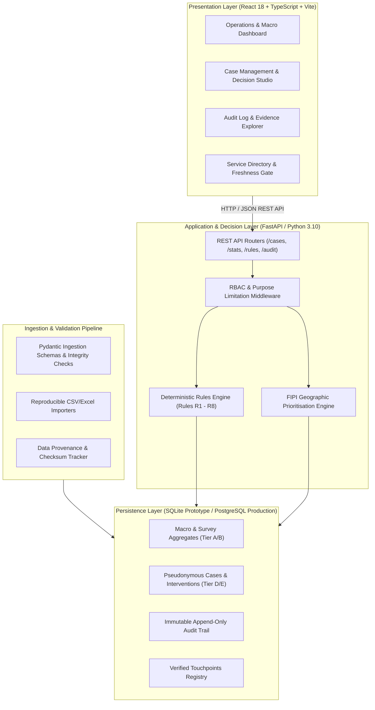

# Financial Inclusion Governance Engine (FIGE): Technical Architecture Specification

**Document Classification:** System Architecture, Data Flow & Infrastructure Blueprint  
**Version:** 1.0.0 (Phase 1 Baseline)  
**Date:** 23 October 2026  
**Auditor Rule:** Keep technology proportionate and maintainable. No LLMs, machine-learning classifiers, or blockchain smart contracts are used where deterministic, explainable, and verifiable algorithms solve the problem.

---

## 1. Architectural Philosophy & Layering

The FIGE system is architected as an auditable, high-performance decision-support platform designed to operate within the strict regulatory boundaries of Indian banking and data protection laws.



---

## 2. Layer Specifications

### 2.1 Presentation Layer (Frontend)
- **Framework:** React 18 with TypeScript, packaged via Vite.
- **Styling & Accessibility:** Tailwind CSS with WCAG 2.1 AA accessibility compliance (high-contrast ratios, keyboard navigation, clear screen-reader aria attributes).
- **Key Modules & Components:**
  1. `OperationsDashboard.tsx`: High-level executive KPI cards displaying the Triangulated Resolution Metrics (Operational Reactivation, Barrier Resolution, Meaningful Use), along with macro inclusion indicators and geographic priority heatmaps.
  2. `CaseManagement.tsx`: Officer workbench displaying individual pseudonymous cases, diagnosed friction points, evidence sources, and permitted next-step routing options.
  3. `EvidenceRulesView.tsx`: Inspectable rules registry explaining each deterministic rule (R1 to R8), statutory trigger conditions, regulatory citations, and guardrails.
  4. `ServiceDirectoryView.tsx`: Interactive touchpoint catalog with automated visual indicators for touchpoint status (Verified, Pending Audit, Expired/Stale $>90$ days).
  5. `AuditTrailView.tsx`: Immutable event explorer enabling compliance officers and external auditors to filter actions by Case ID, Actor Role, Timestamp, and Purpose Code.
- **Visual Evidence Badges:** Every UI view featuring synthetic data renders a prominent, non-dismissible amber badge: `SYNTHETIC DEMO ENVIRONMENT — ZERO REAL PII`.

---

### 2.2 Application & Decision Layer (Backend)
- **Framework:** Python FastAPI (asynchronous, OpenAPI/Swagger auto-documenting).
- **Deterministic Rules Engine (`rules.py`):**
  A pure, explainable Python engine evaluating case conditions against statutory rules R1 to R8 without stochastic drift:
  - **Rule R1 (Explicit Opt-Out & Suppression):** If customer contact permission is declined or consent is withdrawn, immediately suppress all outreach.
  - **Rule R2 (Customer-Confirmed KYC Mismatch):** Route confirmed KYC discrepancies to non-home branches, V-CIP, or authorised BCs per RBI Circular Index 12864.
  - **Rule R3 (Physical Access & Freshness Gate):** Route distance-constrained cases only to accredited BCs verified within 90 days; block stale routes and dispatch to human review.
  - **Rule R4 (Unresolved Grievance & Distrust):** Prioritize pending transaction debit grievances to Internal Ombudsman desks; ban premature reactivation nudges.
  - **Rule R5 (Changed Welfare Utility / DBT):** Neutral education on DBT portability with explicit no-action acceptance; incoming credits preserved.
  - **Rule R6 (Contradictory / Low Evidence Hold):** Refuse automated routing when evidence is unconfirmed or contradictory; lock for Lead Bank Officer review.
  - **Rule R7 (Completed Referral Verification):** Refuse to mark a barrier resolved solely because an appointment or referral was logged; require verified confirmation.
  - **Rule R8 (Meaningful Access Separation):** Refuse to count operational reactivation as success if the citizen states no further use wanted.
- **Geographic Prioritisation Engine (`scoring.py`):**
  Calculates the Financial Inclusion Prioritisation Index (FIPI) at district/state scale using vectorized Pandas/NumPy operations, explicitly applying missing-data penalties.

---

### 2.3 Persistence Layer & Database Migration Path

#### Current Prototype: SQLite 3
- Zero-configuration, file-based relational storage (`bankmitra.db`).
- Enables 100% reproducible execution in local evaluation environments without external database service dependencies.
- Enforces foreign key constraints via `PRAGMA foreign_keys = ON;`.
- WAL (Write-Ahead Logging) mode enabled for high concurrent read performance during testing.

#### Migration Path to PostgreSQL (Production Specification)
When transitioning from the hackathon demonstration to a live multi-tenant institutional pilot:

```
┌─────────────────────────┐          ┌─────────────────────────┐
│     SQLite Prototype    │          │  PostgreSQL Production  │
│  • Single-file embedded │ ───────> │  • Multi-tenant schema  │
│  • Local development    │ Alembic  │  • Connection pooling   │
│  • In-memory testing    │ Migrates │  • Row-Level Security   │
│  • Synthetic datasets   │          │  • AES-256 Column Encr. │
└─────────────────────────┘          └─────────────────────────┘
```

1. **ORM Portability:** The backend utilizes SQLAlchemy 2.0 ORM models with standard ANSI SQL data types (`String`, `Integer`, `Float`, `Boolean`, `DateTime`), ensuring zero vendor lock-in.
2. **Schema Migration Tooling:** Alembic migration scripts (`alembic/versions/`) manage forward and backward DDL evolutions.
3. **PostgreSQL Specific Enhancements:**
   - **Row-Level Security (RLS):** Enforces tenant isolation so Bank A officers cannot query Bank B cases (`CREATE POLICY bank_isolation_policy ON cases USING (bank_id = current_setting('app.current_bank_id'));`).
   - **Append-Only Immutability:** Enforces cryptographic append-only triggers on `audit_events` preventing `UPDATE` or `DELETE` operations even by database administrators.
   - **Connection Pooling:** Managed via PgBouncer or SQLAlchemy's asynchronous `QueuePool` ($pool\_size=20, max\_overflow=10$).

---

## 3. Data Ingestion & Reproducibility Pipeline

Data ingestion follows a strict validation pipeline ensuring bad records are quarantined rather than corrupting the database:

```
   Raw Data Files (CSV / Excel)
                │
                ▼
┌────────────────────────────────┐
│   Cryptographic Checksum Log   │ -> SHA-256 validation against source registry
└───────────────┬────────────────┘
                │
                ▼
┌────────────────────────────────┐
│   Pydantic Schema Validator    │ -> Type checking, range bounds, non-null guards
└───────────────┬────────────────┘
                │
        ┌───────┴───────┐
        │ Valid?        │
        ▼               ▼
   [ YES ]           [ NO ]
      │                 │
      ▼                 ▼
Insert into DB   Quarantine Error Log (`data/quarantine_errors.jsonl`)
```

- **Idempotent Seeding:** `generator.py` and `import_pipeline.py` implement idempotent upserts using primary key conflict resolution (`ON CONFLICT DO NOTHING`), allowing ingestion scripts to run repeatedly without duplicate records.

---

## 4. Role-Based Access Control (RBAC) Architecture

The platform defines four statutory roles with strict principle-of-least-privilege boundaries:

| Statutory Role | Permitted Permissions | Prohibited Actions | Typical Institutional Actor |
|---|---|---|---|
| **`REGULATOR_AUDITOR`** | Read-only access to all macro aggregates, state prioritisation heatmaps, institutional compliance indices, and immutable audit logs. | Cannot view pseudonymous operational case tokens or edit case statuses. | RBI FIDD Inspector, DFS Review Officer. |
| **`LEAD_BANK_OFFICER`** | Full access to institutional review queues, unconfirmed barrier triage (Rule R6), human review overrides, and service directory accreditation. | Cannot export bulk unmasked datasets; cannot override customer opt-out under Rule R1. | Lead District Manager (LDM), District Lead Bank Officer. |
| **`AUTHORISED_BC`** | Read and update assigned field cases; record customer-confirmed barriers and self-reported resolution at follow-up. | Cannot accredit service points; cannot reassign cases across banks. | Bank Sakhi, Corporate BC Agent. |
| **`INDEPENDENT_AUDITOR`**| Cryptographic audit verification; verification of rule execution fidelity and metric reproduction. | Cannot modify operational records or delete audit entries. | Third-party public policy evaluator, IIT Bombay Techfest Jury. |

---

## 5. Security & Threat Modeling

1. **Zero Real PII Ingestion:** The system design completely prohibits ingestion of raw citizen names, 12-digit Aadhaar numbers, Permanent Account Numbers (PAN), Core Banking login credentials, or debit card PINs/OTPs.
2. **Cryptographic Tokenization:** Case identifiers use randomized tokens generated via SHA-256 with rotating server-side salt:
   $$\text{Token} = \text{HMAC-SHA256}(\text{InternalAccountRef}, \text{Salt})$$
3. **Data Minimization:** APIs return only fields strictly required for the specific user role's workflow (DPDP Act 2023 Section 6 compliance).
